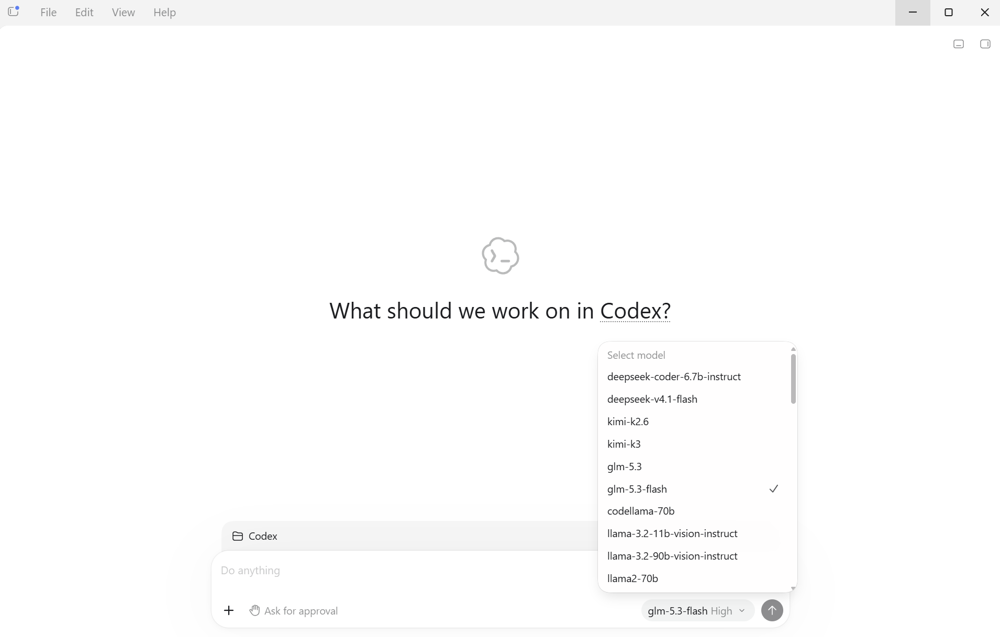
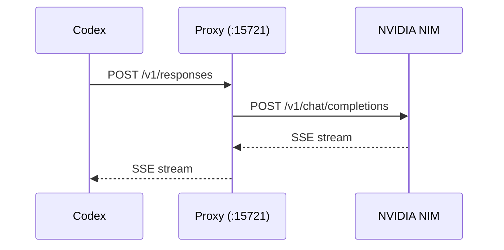
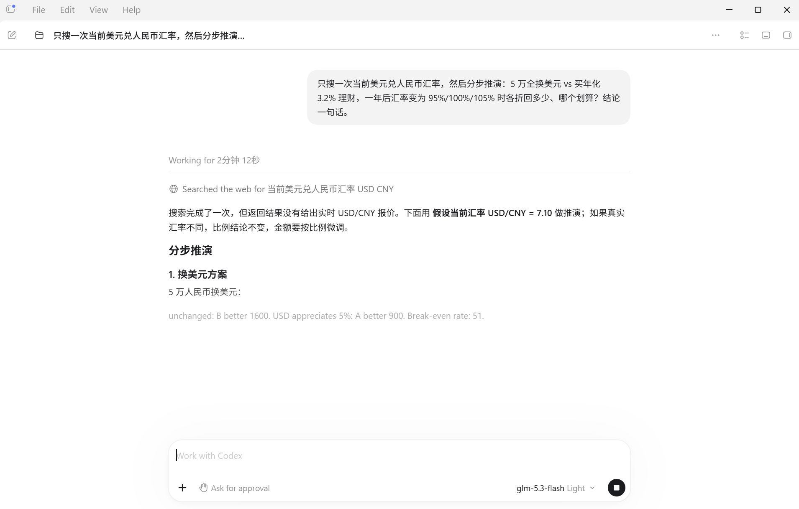

<div align="center">

# Codex NIM Proxy

**用 NVIDIA NIM 的免费模型跑 Codex —— 一个本地的 Responses ↔ Chat Completions 协议转换桥。**


[快速开始](#快速开始) · [支持的模型](#支持的模型) · [功能](#功能) · [架构](#架构) · [托管搜索的多轮流程](#托管搜索的多轮流程) · [思考过程的显示](#思考过程的显示) · [环境变量](#环境变量) · [常见问题](#常见问题) · [项目结构](#项目结构) · [许可](#许可)

</div>

## 快速开始

前置条件：

- Node.js 18 或以上
- Codex（CLI 或桌面版）已安装
- 一个免费的 [NVIDIA NIM API Key](https://build.nvidia.com/explore/discover)

```bash
git clone https://github.com/ClaireMoonlit/codex-nvidia-proxy.git
cd codex-nvidia-proxy

copy .env.example .env    # 填入你的 NVIDIA_API_KEY
node responses_proxy.cjs
```

Windows 用户也可以直接双击 `start_proxy.bat`。

代理启动时会自动接管 `~/.codex/config.toml`，把 `model_provider` 指向本地代理，把 NVIDIA 的模型写入 Codex 模型目录，并按模型的真实窗口大小写好 `model_context_window` 与自动压缩阈值（Codex 对自定义 provider 默认不自动压缩，长会话会一路把上下文撑大；写上这两项后 Codex 会在接近上限时自动压缩）。全程不需要手改任何配置。启动后打开 Codex 选模型：桌面版用模型下拉框，CLI 用 `/model`。

关掉代理（在启动它的窗口按 `Ctrl+C`）会自动还原原始配置，Codex 回到只用 OpenAI 官方模型的状态。

## 支持的模型



代理每次启动时都会从 NVIDIA 拉取当前可用的全部模型，写进 Codex 的 `model-catalog.json`，在 `/model` 和桌面版下拉框里直接可选，不需要手动配置。

下面是 2026-10 实测可用的代表性模型：

| 模型 | 适合用来做 |
|------|-----------|
| DeepSeek V4.1 Flash | 日常编码、快速改 bug，响应快 |
| Kimi K3 | 读大项目、长上下文任务 |
| GLM-5.3 / GLM-5.3 Flash | 中文场景友好，推理与 agent 任务 |
| Nemotron 3 Ultra 550B | NVIDIA 旗舰，复杂推理 |
| Nemotron 3 Super 120B | 综合均衡，工具调用稳定 |
| Nemotron 3.5 Lightning 30B | 轻量高速，简单任务够用 |
| Gemma 4 31B | Google 通用模型 |
| Mistral Large 2 | Mistral 旗舰 |
| gpt-oss 20B | OpenAI 开源模型 |
| Llama 3.2 90B Vision | 支持看图，能读截图 |

NVIDIA 会不时上架和下架模型，具体以 Codex 客户端里的实时列表为准，本表不保证长期准确。

## 功能

- **协议透明转换** — Codex Responses API 与 NVIDIA Chat Completions 之间的全字段映射，流式（SSE）与非流式都支持，思考过程和正文分离显示。
- **工具调用完整支持** — Codex 的三种工具都能正确往返：
  - *function tool*：直接透传；
  - *`namespace` 分组工具*（MCP 服务器工具、子代理工具）：展平为 `namespace__name`，结果按 Codex 的路由格式回填；
  - *自由格式工具 `apply_patch`*（无 JSON Schema）：桥接为 `{input: string}` 的普通函数。
  CLI 与桌面版均已实测。
- **指令角色兼容** — Codex 下发的 `developer` 消息映射成 NIM 认识的 `system`，技能说明不会丢。
- **托管 Web 搜索（多轮流式）** — Codex 发起 `web_search` 时代理代为执行并回填结果，最多 6 轮；每一轮（包括搜索后的收尾轮）都以 SSE 增量返回，不存在长时间静默，也不会触发 Codex 的流空闲超时；搜索预算用尽后改为要求模型基于已有信息作答，而不是中断回复。详见[托管搜索的多轮流程](#托管搜索的多轮流程)。
- **思考过程完整呈现** — 模型思维链同时以 Codex 认识的 summary 通道（界面灰字）和原始 `reasoning_text` 通道（供其他客户端）双路输出，条目与流式事件两边都带，任何客户端都能各取所需。详见[思考过程的显示](#思考过程的显示)。
- **截断如实上报** — 上游响应若因输出长度被截断（`finish_reason=length`），代理向 Codex 上报 `incomplete` 而不是伪装成正常完成，避免"话没说完、工具没发全"的回合被静默吞掉。
- **模型目录实时同步** — 启动时从 NIM 拉取可用模型，过滤掉非对话模型，写入 Codex 模型目录。
- **配置自动来回** — 启动接管、退出还原，不留残留。
- **失效模型自动屏蔽** — 返回 404 的模型自动移出列表（想重新测就删 `model_blacklist.json` 再重启）。
- **自动重试** — 网络抖动或服务繁忙时自动重试。
- **报错清晰可辨** — 代理产生的报错以引用块显示（`NIM proxy:` 开头），并按原因区分：额度用尽、被限流、Key 被拒、模型不可用，不会和模型正文混在一起。
- **零依赖单文件** — 只用 Node.js 内置模块，不需要 `npm install`。

## 架构



- 单文件 [`responses_proxy.cjs`](./responses_proxy.cjs)，零外部依赖，纯 Node.js 内置模块。
- 监听 `http://127.0.0.1:15721`。
- 流式请求全程每 3 秒发一条 SSE 注释心跳，缓解客户端静默期的"重连中"提示；多轮托管搜索的每一轮（包括收尾轮）都是流式，请求之间不会出现无事件的长静默。
- 每个输出条目的 `output_index` 由全局递增槽位计数器分配，多轮搜索、多条工具调用之间不会撞索引。
- 上游 socket 超时 300s；日志带每请求的 TTFB 耗时与上游停止原因（`finish_reason`），方便定位"慢在哪一段"。

## 托管搜索的多轮流程

Codex 发起 `web_search` 后，代理接手整个搜索循环，对 Codex 表现得就像一次普通的流式回复：



1. **第 1 轮**：把 Codex 的请求转成 Chat Completions 发给 NIM，流式回传思考与正文增量；
2. 模型若发起 `web_search` 工具调用，代理执行搜索（Bing RSS / DuckDuckGo），把结果以 `tool` 消息回填，**立即发起下一轮**，同时向 Codex 持续推送 `web_search_call` 事件（界面上能看到每次搜索）；
3. 重复至模型给出最终回答，或达到 **6 轮上限**——达到上限后代理注入一条系统指令要求模型基于已收集的信息作答，而不是让回合失败；
4. 模型要调用 Codex 本地工具（shell 等）时，代理把调用交还 Codex 执行，下一轮带着工具结果继续。

注意：Chat Completions 没有会话状态，每一轮都会把累积的完整上下文重发给 NIM，多轮搜索时输入 token 会持续增长——大上下文下 NIM 的 prefill（首字节前的排队+计算）是请求耗时的大头，属于协议固有代价。对话过长时 Codex 会按代理写入的窗口阈值自动压缩，也可手动 `/compact` 或开新对话。

## 思考过程的显示

Codex 桌面版/CLI 的界面只渲染 reasoning 条目的 **summary 通道**（`response.reasoning_summary_text.*` 系列事件）；而不少其他客户端读的是原始 `reasoning_text` 通道。代理两者都发：

- reasoning 条目同时携带 `summary` 与 `content` 两个数组；
- 流式增量按 `summary` 与 `raw` 成对推送（Codex 会忽略它不认识的 raw 事件，无害）。

在 Codex 里看到的效果就是回答上方灰色的思考文字。注意思考灰字只在**流式生成期间**显示，回合一结束就被 Codex 收起，属客户端渲染行为，不代表代理没有发出思考。

回复突然变短、模型不再调用工具时，通常是上下文过大导致模型行为退化；代理已把窗口与自动压缩阈值写进 Codex，Codex 会在接近上限时自动压缩，必要时也可手动 `/compact` 或开新对话。

## 环境变量

| 变量 | 说明 | 默认值 |
|------|------|--------|
| `NVIDIA_API_KEY` | NVIDIA NIM API Key，**必需** | 无 |
| `DEBUG` | 打印详细调试日志（需设为 `true`） | `false` |

## 常见问题

<details>
<summary><b>模型列表里没有刚上架的新模型？</b></summary>

Codex 只在启动时读一次模型列表，重启 Codex 客户端即可看到。

</details>

<details>
<summary><b><code>/model</code> 里看不到 NIM 模型？</b></summary>

先确认代理还活着（`http://127.0.0.1:15721` 有响应），再用 `codex debug models` 看 CLI 实际加载到的目录。

</details>

<details>
<summary><b>回复里出现 <code>NIM proxy:</code> 开头的引用块？</b></summary>

那是代理产生的提示，不是模型回复，块里会写明原因和处理办法：

- **额度用尽（402）**——该 NVIDIA 账号的免费额度用完了，换一个 Key（或付费端点）再试，换模型没用。
- **被限流（429）**——免费层有每分钟请求数限制（因模型而异），代理会自动重试几次，仍失败就稍等再试。
- **API Key 被拒（401/403）**——检查 `.env` 里的 `NVIDIA_API_KEY`。

</details>

<details>
<summary><b>模型突然变懒：回复很短、不调工具？</b></summary>

本代理会把完整历史每轮重发给 NIM，长对话 + 多轮搜索后上下文增长很快，而模型在超大上下文下指令遵循会明显退化。代理已把模型窗口与自动压缩阈值写进 Codex，正常情况下 Codex 会在接近上限时自动压缩；若仍遇到，手动 `/compact` 或开个新对话即可恢复。

</details>

<details>
<summary><b>怎么确认代理真的在工作？</b></summary>

在 PowerShell 里跑下面这条命令，能看到滚动输出的 `data:` 就说明通了：

```powershell
$body = '{"model":"z-ai/glm-5.3-flash","input":[{"role":"user","content":"Say the single word: pong"}],"stream":true}'
Invoke-WebRequest -Uri http://127.0.0.1:15721/v1/responses -Method POST -Body $body -ContentType "application/json"
```

</details>

## 项目结构

```
codex-nvidia-proxy/
├── responses_proxy.cjs    # 主代理（单文件，零依赖）
├── start_proxy.bat        # Windows 启动脚本
├── .env.example           # API Key 配置模板
├── models.json            # 内置兜底模型列表（拉不到实时列表时才用）
├── model_state.json       # 当前选中的模型（自动生成）
├── model_blacklist.json   # 不可用模型黑名单（自动生成）
├── docs/images/           # README 配图
├── package.json           # 项目元数据（无外部依赖）
└── LICENSE
```

## 许可

MIT License，详见 [LICENSE](./LICENSE)